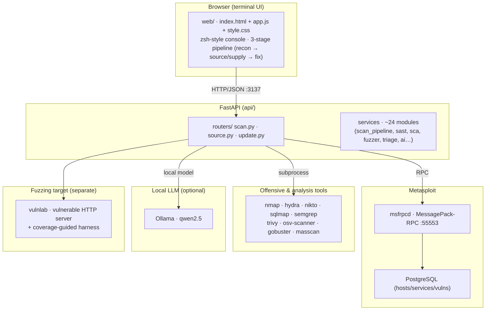
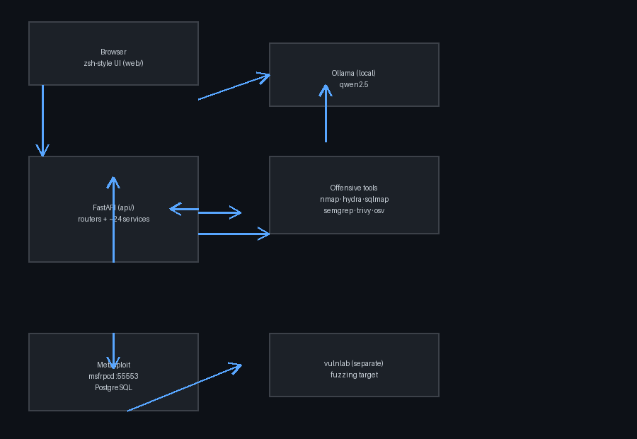
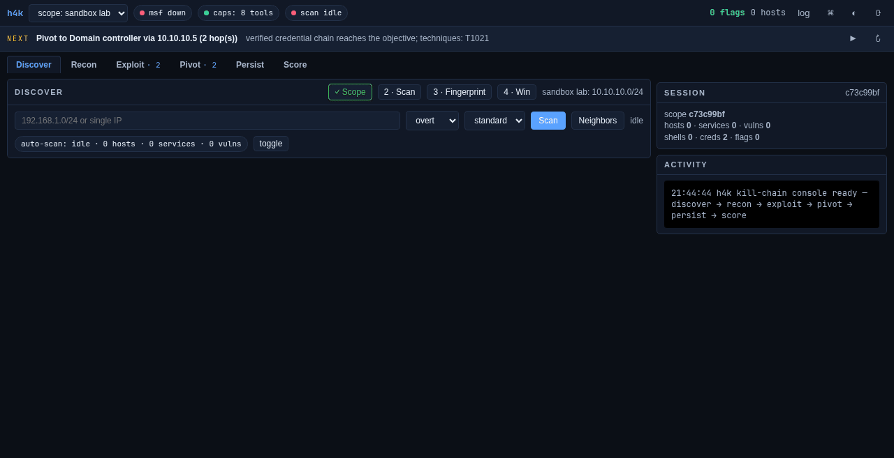

<div align="center">

# ⚡ h4k — Intrusion Suite

**A containerized security analysis platform for authorized lab testing.**

Recon your own lab, fuzz the software you run, and ship a responsible-disclosure
report — all from one container.

[](LICENSE)


</div>

---

## What is h4k?

**h4k** is a self-contained, **Dockerized offensive-security analysis platform**
built for a school capstone. It drives the **Metasploit Framework** over its RPC
interface and layers a modern analysis stack on top — so you can go from *"what's
on this host?"* to *"here's a fuzzed crash, a root-cause, and a patch direction."*

It's built for **authorized lab work only** — your own VMs, a test router, a
Metasploitable box. Every aggressive action is **off by default and opt-in**.

### What it can do

| Area | Capabilities |
|------|--------------|
| **Host recon & scan** | 3 OPSEC modes (stealth / Tor / overt), fingerprinting, PTR, DNS, ARP neighbors, posture heuristic |
| **Vuln analysis** | curated CVE archive, EOL/version leads, default-cred archive, ranked recommendations |
| **Source analysis (SAST)** | upload `.zip/.tar/.tar.gz` or clone a git URL → Semgrep + heuristics |
| **Supply-chain (SCA)** | SBOM (CycloneDX) + osv-scanner → known CVEs + secrets/license scan |
| **Fuzzing** | black-box HTTP fuzz *and* a bundled coverage-guided lab (libFuzzer/AFL++ + ASan) |
| **Triage & exploits** | crash → bug-class/CWE → minimized repro → PoC/disclosure skeleton |
| **AI assistance** | local **Ollama** (qwen2.5) → root-cause + patch-candidate |

---

## Quickstart (get running in ~2 minutes)

### 1. Build & run the platform

```sh
cd h4k
docker build -t h4k .

docker run --rm --network host -p 3137:3137 \
  -e API_PORT=3137 -e MSF_PASSWORD=h4k_msf_rocks \
  -e H4K_AI_PROVIDER=ollama -e OLLAMA_BASE_URL=http://127.0.0.1:11434 -e H4K_AI_MODEL=qwen2.5:latest \
  h4k
```

> **Note:** `docker build` alone does **not** leave the container running.
> You must `docker run` (or `docker compose up`) to start the service.

Open **http://localhost:3137** in your browser.

### 2. (Optional) Run the fuzzing lab target in its own container

```sh
cd vulnlab
docker build -t vulnlab .
docker run --rm --name vulnlab -p 127.0.0.1:8080:8080 vulnlab
```

Or start everything together:

```sh
docker compose up --build            # platform + vulnlab
docker compose --profile llm up      # + Ollama sidecar on 127.0.0.1:11435
```

---

## First steps (for someone brand new)

1. **Open the web UI** — `http://localhost:3137`.
2. **Scan a lab target** — enter an IP/host you own (e.g. a Pi or VM), pick
   **Overt**, hit **run scan**. Watch the console stream and the report build.
3. **Find neighbors** — hit **find neighbors (arp)** to map your local segment.
4. **Analyze source** — click **SAST source analysis**, paste a git URL or
   upload a `.zip`, and see findings (Semgrep + heuristics).
5. **Check supply chain** — paste a git URL with a committed lockfile (see
   `demos/sca-demo/`) into **SBOM / SCA** to see instant known-CVE hits.
6. **See the AI path** — hit **AI root-cause + patch** (needs local Ollama, or set
   `H4K_AI_KEY` for an OpenAI-compatible endpoint).
7. **Fuzz a lab target you own** — start the `vulnlab` container and point the
   **lab fuzz** at `127.0.0.1:8080`.

> **Every aggressive toggle (creds, exploits, deep toolkit, fuzz) requires an
> explicit opt-in and only targets systems you own or have written permission
> to test.**

---

## Real-world workflow: from crash to disclosure

```
1. Fuzz a service you own        → anomaly/teardown detected
2. Minimize the repro            → smallest triggering input
3. Triage (bug-class + CWE)      → e.g. stack-buffer-overflow / CWE-120
4. AI root-cause + patch         → local Ollama suggests a fix direction
5. Generate PoC skeleton        → for responsible disclosure (never a weapon)
6. Re-fuzz to verify             → confirm the fix removed the crash
```

This mirrors the process real security teams use — and it's the whole point of
the project.

---

## Architecture





### It animates, too

Watch a live scan run end-to-end:



## Documentation

- **[README (this file)](README.md)** — you are here.
- **[RELEASE_NOTES.md](RELEASE_NOTES.md)** — feature inventory + design decisions.
- **[ROADMAP.md](ROADMAP.md)** — future work, prioritized.
- **[AGENTS.md](AGENTS.md)** — technical context for AI agents working on the
  repo (services map, gotchas, dev loop).
- **[h4k/README.md](h4k/README.md)** — the in-repo PHRACK-style ezine.
- **[vulnlab/README.md](vulnlab/README.md)** — the fuzzing-lab target.

---

## Project layout

```
HACKING/                git root
  .venv/                local dev venv (host tooling, NOT in the container)
  AGENTS.md             AI-agent context
  RELEASE_NOTES.md      features + design decisions
  ROADMAP.md            future work
  Makefile · pyproject.toml   lint/test config
  h4k/                  the main platform image
    api/                FastAPI app (routers + ~24 services)
    web/                terminal-style UI
    data/               CVE/creds archives + wordlists
    Dockerfile · docker-compose.yml · entrypoint.sh
  vulnlab/              intentionally-vulnerable fuzzing target + harnesses
  demos/sca-demo/       SCA fixture (pins vulnerable lodash)
  tests/                pytest suites (315 tests)
```

## Development

Requirements: a recent Python 3.11+ and Docker.

```sh
python3 -m venv .venv && source .venv/bin/activate
pip install -r requirements-dev.txt

make fmt     # black + isort
make lint    # black ruff isort flake8 mypy pylint bandit
make test    # pytest (315 tests)
make coverage # pytest --cov (70% gate, currently 74.6%)
```

All linters pass and the suite is green. Tests run offline (a mocked Metasploit
backend powers the API tests — no live daemon needed).

---

## License

[MIT](LICENSE) — with an **ethical-use notice**. Use it only for authorized
security education and testing.

## Acknowledgements

Built on [Metasploit Framework](https://www.metasploit.com/), Semgrep,
Trivy, osv-scanner, libFuzzer/AFL++, and FastAPI. **h4k** wires them together for
a learning-focused, lab-safe workflow.

---
**Authorized lab use only.** You must own a system or have written permission to
test it. A proxy chain or Tor circuit never makes an unauthorized scan lawful.
