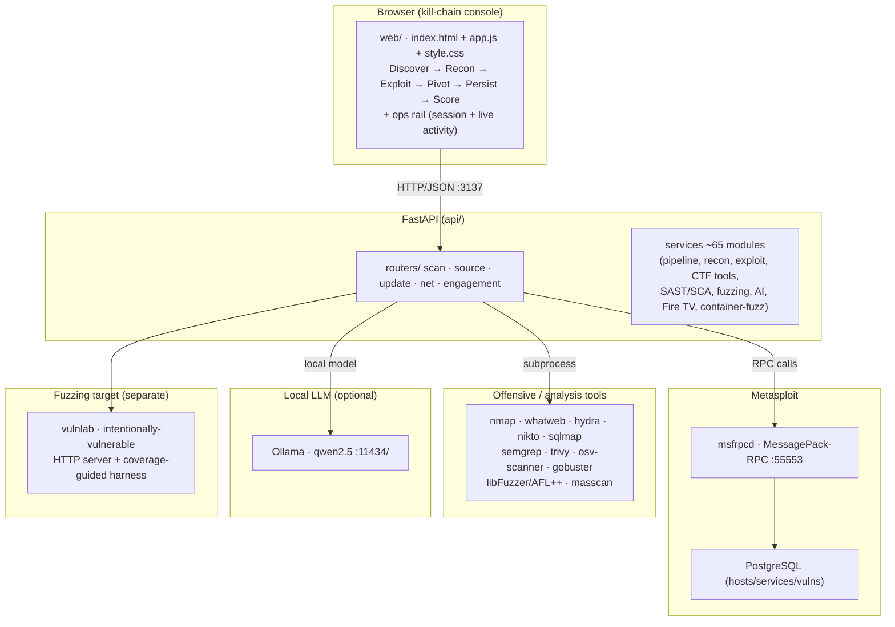

<div align="center">

# ⚡ h4k - Intrusion Suite

**A containerized security analysis platform for authorized lab testing.**

Recon your own lab, fuzz the software you run, and ship a responsible-disclosure
report - all from one container.

[](LICENSE)
[](https://github.com/Greg-2600/h4k/actions)


</div>

---

## What is h4k?

**h4k** is a self-contained, **Dockerized offensive-security analysis platform**
built for a school capstone. It drives the **Metasploit Framework** over its RPC
interface and layers a modern analysis stack on top - so you can go from *"what's
on this host?"* to *"here's a fuzzed crash, a root-cause, and a patch direction."*

It's built for **authorized lab work only** - your own VMs, a test router, a
Metasploitable box. Every aggressive action is **off by default and opt-in**.

### What it can do

| Area | Capabilities |
|------|--------------|
| **Host recon & scan** | 3 OPSEC modes (stealth / Tor / overt), fingerprinting, PTR, DNS, ARP neighbors, posture heuristic |
| **Passive auto-scan** | on boot, h4k starts building a network and service map of the local subnet automatically - recon only, no creds, no exploits; the map is live at `/api/map` and in the console |
| **Vuln analysis** | curated CVE archive, EOL/version leads, default-cred archive, ranked recommendations |
| **Engagements** | persistent scope-enforced asset graph; replays *verified* credentials across the in-scope estate to find where they also work (lateral movement), with a dry-run plan first |
| **Attack paths** | declare **crown jewels** (the objectives that matter) and get scored, evidence-backed paths to them - a 2.0 leak that pivots into the DC outranks a 9.8 on an isolated box |
| **ATT&CK & detection** | every finding mapped to a MITRE ATT&CK technique, each with defender telemetry (log sources, event IDs) |
| **Source analysis (SAST)** | upload `.zip/.tar/.tar.gz` or clone a git URL → Semgrep + heuristics |
| **Supply-chain (SCA)** | SBOM (CycloneDX) + osv-scanner → known CVEs + secrets/license scan |
| **Fuzzing** | signal-guided HTTP mutation fuzzer with **crash dedup** (distinct bugs, not raw crash counts) *and* a bundled coverage-guided lab (libFuzzer/AFL++ + ASan) |
| **Triage & exploits** | crash → bug-class/CWE → minimized repro → PoC/disclosure skeleton |
| **AI assistance** | keyless local **opencode relay** (free models) or any OpenAI-compatible server → root-cause + patch-candidate |

---

## Quickstart (get running in ~2 minutes)

### 1. Build & run the platform

```sh
cd h4k
docker build -t h4k .

# AI triage (optional, keyless): start the opencode relay on the host first -
#   OPENCODE_MODEL=opencode/beam-free python3 h4k/scripts/opencode_relay.py

docker run -d --name h4k --network host -p 3137:3137 \
  -v h4k_data:/opt/h4k/data \
  -e API_PORT=3137 -e MSF_PASSWORD=h4k_msf_rocks \
  -e H4K_AI_PROVIDER=openai_compatible -e H4K_AI_KEYLESS=1 \
  -e H4K_AI_URL=http://127.0.0.1:3777/v1/chat/completions \
  -e H4K_AI_MODEL=opencode/beam-free \
  h4k
```

> The h4k_data volume keeps your session (discovered hosts, services, findings,
> credentials) across container rebuilds. Scope choice persists too.

> **Note:** `docker build` alone does **not** leave the container running.
> You must `docker run` (or `docker compose up`) to start the service.

Open **http://localhost:3137** in your browser.

### 2. (Optional) Run the fuzzing lab target in its own container

```sh
cd vulnlab
docker build -t vulnlab .
docker run --rm --name vulnlab -p 127.0.0.1:8080:8080 vulnlab
```

Or start everything together (platform + vulnlab):

```sh
docker compose up --build
```

---

## First steps (for someone brand new)

The UI is a kill-chain console: **Discover → Recon → Exploit → Pivot →
Persist → Score**. The Workflow strip on Discover tracks scope → scan →
fingerprint → win; the next-action strip floats the single best move.

1. **Set the scope** - pick your engagement in the header scope selector
   (authorizes the aggressive actions; persists across restarts).
2. **Discover** - **Discover** tab → target + **Scan**. Results flow into
   **Recon**: **Fingerprint services**, then review **Likely vulnerable**.
3. **Judge it** - the **⚠ Likely Vulnerable** card flags known CVEs;
   password-attack targets list under **Exploit**.
4. **Act deliberately** - **Attack queue** entries each carry a fire button;
   every action is logged verbatim in the Activity pane and in `docker logs`.
5. **Pwned?** - sessions are captured automatically (💀 on the graph, quick
   actions + free-form shell console attached to the finding).
6. **Report** - **Score** tab → **Report** card → **Download MD**: scope,
   hosts, findings, verified creds, sessions, and every attempted action.

Prefer one button? **Exploit** tab → **Autopilot** card → **Start full attack**:
the whole walk (discover → fingerprint → CVEs → password attacks → exploits)
with a live named-action log. Requires the scope. The **Fuzz lab** card points
at your own lab target (vulnlab container included) for the crash → minimize
→ triage loop.

7. **Fuzz a lab target you own** - start the `vulnlab` container and point the
   **lab fuzz** at `127.0.0.1:8080`.

> **Every aggressive toggle (creds, exploits, deep toolkit, fuzz) requires an
> explicit opt-in and only targets systems you own or have written permission
> to test.**

---

## Real-world workflow: from crash to disclosure

```
1. Fuzz a service you own        → anomaly/teardown detected
2. Minimize the repro            → smallest triggering input
3. Triage (bug-class + CWE)      → e.g. stack-buffer-overflow / CWE-120
4. AI root-cause + patch         → keyless opencode relay / any OpenAI-compatible gateway
5. Generate PoC skeleton        → for responsible disclosure (never a weapon)
6. Re-fuzz to verify             → confirm the fix removed the crash
```

This mirrors the process real security teams use - and it's the whole point of
the project.

---

## Architecture




### It animates, too

Watch a live scan run end-to-end:


## Documentation

- **[docs/](docs/index.md)** - the full documentation set: quickstart, concepts,
  workflows, UI guide, safety, troubleshooting, architecture, API reference,
  testing guide, threat model, scope spec, secrets handling, examples -
  including a [real engagement write-up](docs/examples/finding-pi-hole-192-168-1-26.md)
  (unauthenticated Transmission RPC → arbitrary file write).
- **[README (this file)](README.md)** - you are here.
- **[RELEASE_NOTES.md](RELEASE_NOTES.md)** - feature inventory + design decisions.
- **[ROADMAP.md](ROADMAP.md)** - future work, prioritized.
- **[AGENTS.md](AGENTS.md)** - technical context for AI agents working on the
  repo (services map, gotchas, dev loop).
- **[h4k/README.md](h4k/README.md)** - the in-repo PHRACK-style ezine.
- **[vulnlab/README.md](vulnlab/README.md)** - the fuzzing-lab target.

---

## Project layout

```
h4k/                   git root
  .venv/                local dev venv (host tooling, NOT in the container)
  AGENTS.md             AI-agent context
  RELEASE_NOTES.md      features + design decisions
  ROADMAP.md            future work
  docs/                 full documentation set (user / dev / security / examples)
  Makefile · pyproject.toml   lint/test config
  h4k/                  the main platform image
    api/                FastAPI app (routers + ~60 services)
    web/                kill-chain console (Discover → Recon → Exploit → Pivot → Persist → Score)
    data/               CVE/creds archives + wordlists
    Dockerfile · docker-compose.yml · entrypoint.sh
  vulnlab/              intentionally-vulnerable fuzzing target + harnesses
  demos/sca-demo/       SCA fixture (pins vulnerable lodash)
  tests/                pytest suites (unit + API) and tests/e2e/ (Selenium)
```

## Development

Requirements: a recent Python 3.11+ and Docker.

```sh
python3 -m venv .venv && source .venv/bin/activate
pip install -r requirements-dev.txt
pip install selenium        # only needed for `make e2e`

make fmt     # black + isort
make lint    # black ruff isort flake8 mypy pylint bandit
make test    # pytest (unit + API)
make e2e     # Selenium browser suite (headless Chrome)
make coverage # pytest --cov (90% gate)
```

All linters pass and the suite is green. Tests run offline (a mocked Metasploit
backend powers the API tests - no live daemon needed).

The **Selenium suite** drives a real browser against a real API started in
**sandbox mode** (`H4K_SANDBOX=1`): nmap, hydra and Metasploit are replaced by
deterministic stand-ins, so it never touches the network and always sees the
same lab estate. It also fails a test if the browser logs an uncaught
JavaScript error - which is how the Report page's missing
`renderReportPreview()` was found.

```sh
sudo pacman -S chromium chromedriver   # Arch
sudo apt install chromium chromium-driver  # Debian/Ubuntu
make e2e
```

---

## License

[MIT](LICENSE) - with an **ethical-use notice**. Use it only for authorized
security education and testing.

## Acknowledgements

Built on [Metasploit Framework](https://www.metasploit.com/), Semgrep,
Trivy, osv-scanner, libFuzzer/AFL++, and FastAPI. **h4k** wires them together for
a learning-focused, lab-safe workflow.

---
**Authorized lab use only.** You must own a system or have written permission to
test it. A proxy chain or Tor circuit never makes an unauthorized scan lawful.
